# São Paulo Atento

**App Flutter que mostra, de forma simples, o que pede atenção no Centro de São Paulo: calor, mobilidade e limpeza urbana. Ele resume tudo em um número, gera alertas que explicam a si mesmos e deixa a decisão final sempre com uma pessoa.**

FIAP · Ciência da Computação · Cross-Platform Application Development · Global Solution 2026.2 · desafio *Territory Predictive Insights*

---

## 2. Problema e público

O Centro de São Paulo (Subprefeitura Sé) sofre com três problemas que costumam ser tratados só depois que acontecem:

- **Calor e clima:** sensação térmica extrema, UV alto e chuvas que alagam ruas.
- **Mobilidade:** ônibus lotados, viagens longas e picos de sinistros.
- **Limpeza urbana:** lixo e entulho descartados em locais proibidos, que entopem canaletas.

**Público:** gestores e técnicos (prefeitura, Defesa Civil, transporte, limpeza), que avaliam alertas e registram decisões, e cidadãos, que acompanham a situação e enviam relatos públicos, sem identificação de quem escreveu.

**Impacto esperado:** mais dias de antecedência para agir e decisões apoiadas em números conferíveis, com a participação de quem vive no território.

---

## 3. Integrantes

| Nome completo | RM |
|---|---|
| Fernando Caires Silva | 563415 |
| Guilherme Martins Rezende | 563500 |
| Raphael Mischiatti de Souza | 563567 |

---

## 4. Demonstração visual

As capturas ficam em `assets/capturas/`.

| | | |
|:-:|:-:|:-:|
| 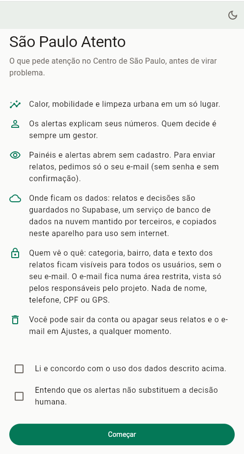<br>Boas-vindas e aceite | 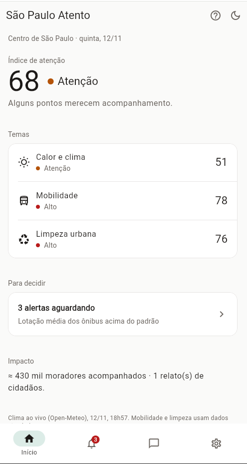<br>Início | 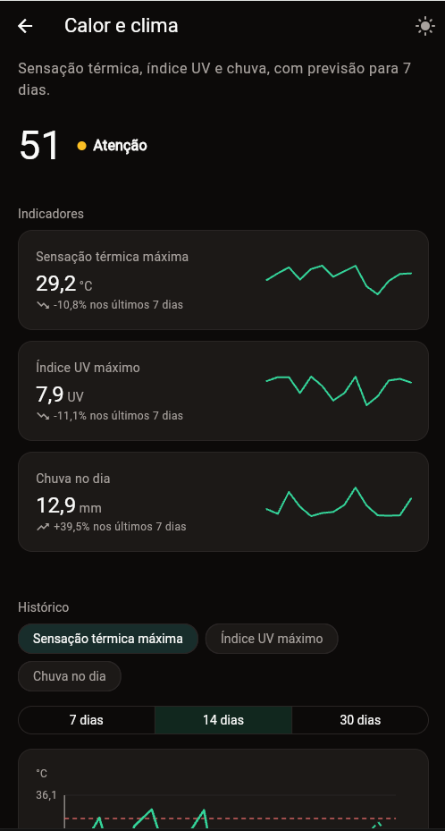<br>Painel Calor e clima |
| 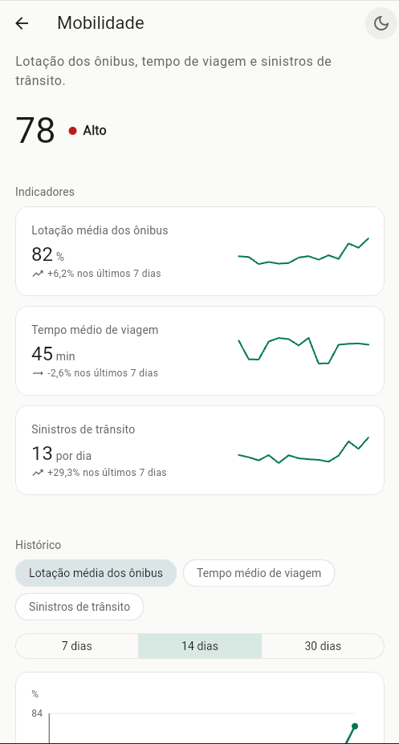<br>Painel Mobilidade | 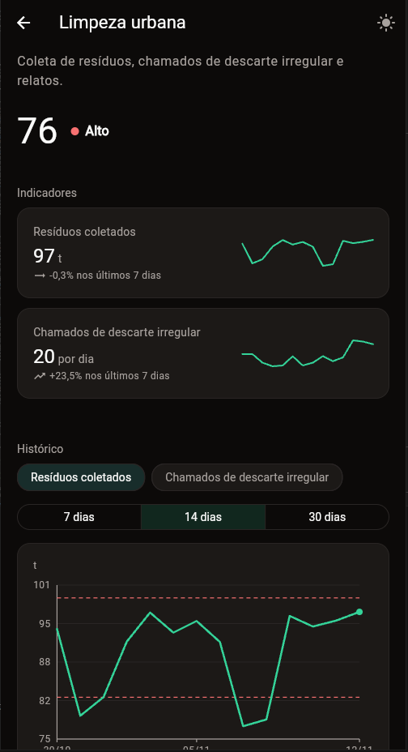<br>Painel Limpeza urbana | 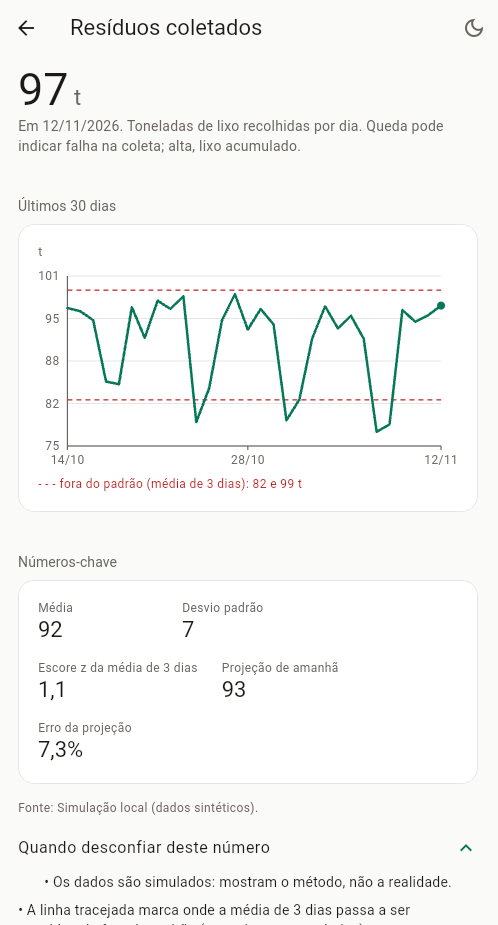<br>Indicador |
| 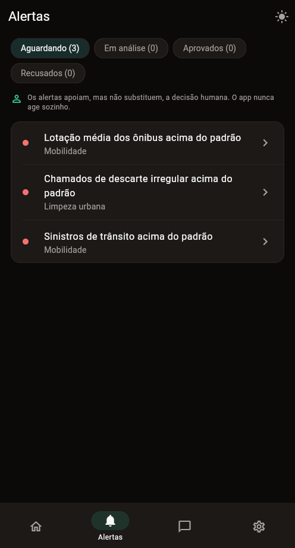<br>Alertas | 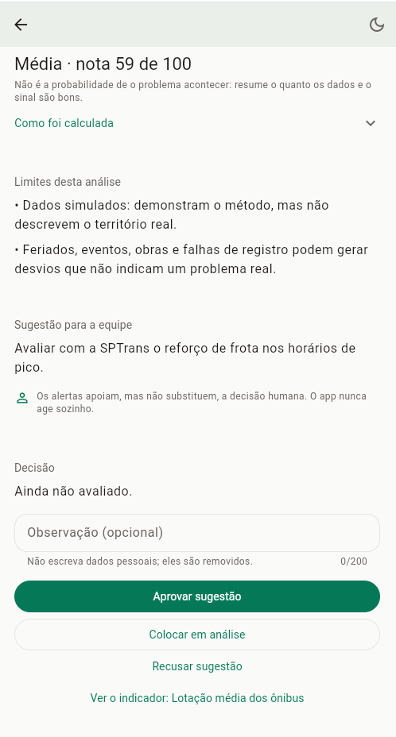<br>Alerta e decisão | 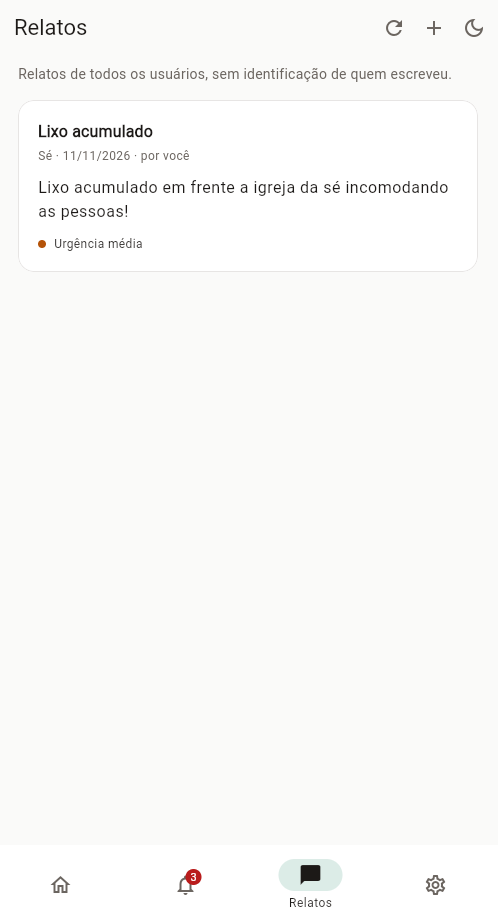<br>Relatos |
| 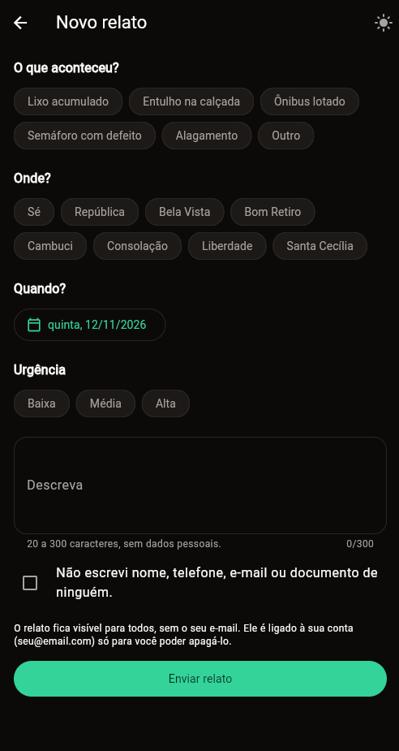<br>Novo relato (validação) | 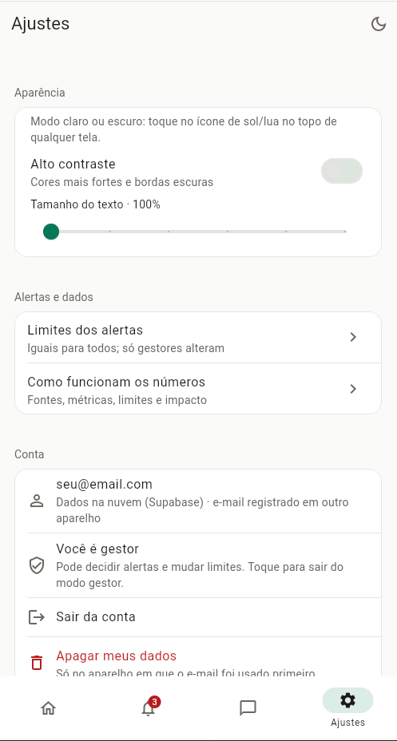<br>Ajustes | 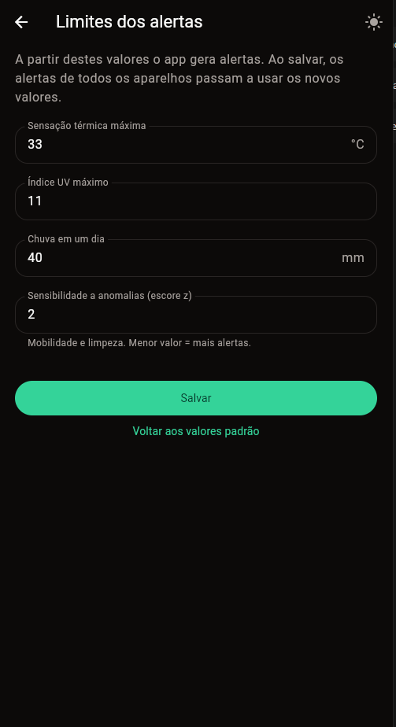<br>Limites dos alertas |
| 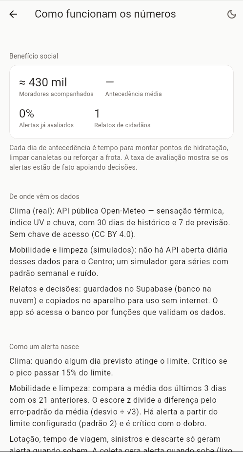<br>Como funcionam os números | 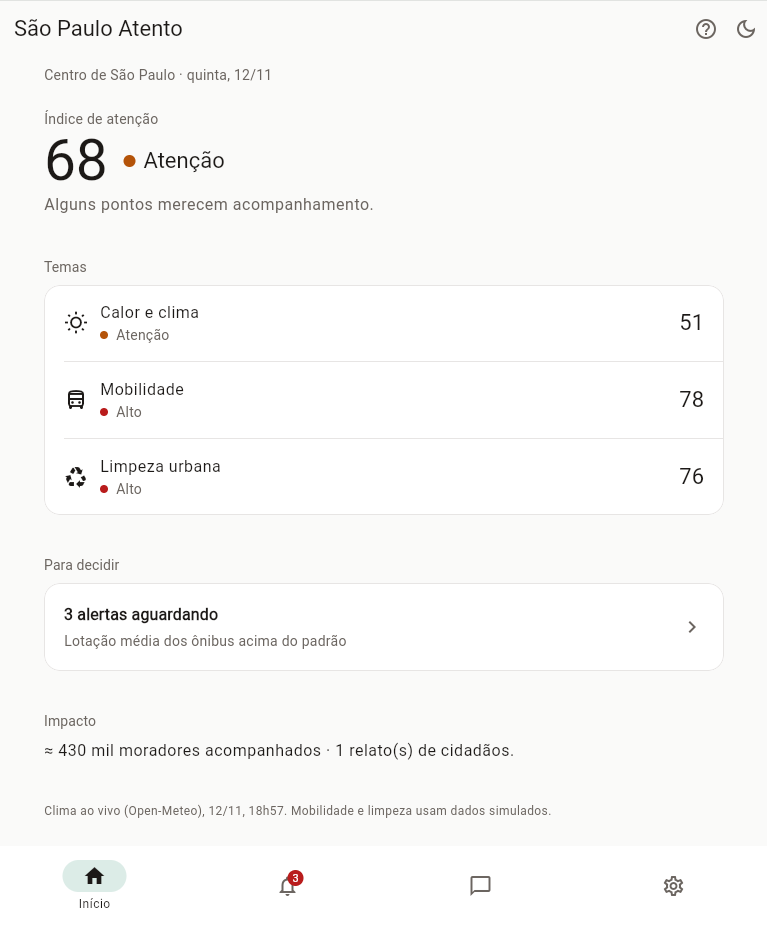<br>Tablet / navegador |

---

## 5. Funcionalidades

**Princípio de design: uma informação principal por tela.** Os detalhes ficam a um toque, em telas de detalhe ou seções recolhíveis. Há uma única cor de destaque, e as cores de estado aparecem só em pequenos pontos.

- [x] **14 telas** com rotas nomeadas e parâmetros (`/indicador/:id`, `/alerta/:id`), no fluxo Início → Painel → Indicador → Alerta
- [x] **4 abas** (Início, Alertas, Relatos, Ajustes) que guardam o próprio estado. O rótulo aparece só na aba ativa
- [x] **3 dashboards distintos, cada um com a sua tela** (`PainelCalorScreen`, `PainelMobilidadeScreen`, `PainelLimpezaScreen`), com índice do tema, cartões de indicador com **tendência real** (últimos 7 dias contra os 7 anteriores, com seta) e minigráfico, gráfico de histórico **com eixos X (datas) e Y (valores)** e linha de referência (limite ou faixa "fora do padrão"), um destaque próprio (próximos dias, lotação por dia da semana, relatos por categoria) e os alertas do tema
- [x] **Índice de Atenção** (0–100), geral e por tema
- [x] **Alertas** por previsão acima do limite e por anomalia (escore z da média, nos dois sentidos para a coleta). Cada um traz o porquê, a **qualidade da evidência** (nota de 0 a 100, com o cálculo recolhível e o MAPE como fator), os limites da análise e uma sugestão. O id usa o primeiro dia do episódio, então a decisão não se perde de um dia para o outro
- [x] Aviso **"os alertas apoiam, mas não substituem, a decisão humana"**, e registro da decisão (aprovar com confirmação, analisar ou recusar) **só por gestores cadastrados**, com PIN. O app não executa nenhuma ação
- [x] **Estado global** em 3 stores (`ChangeNotifier` + `InheritedNotifier`) usados por várias telas. **Estado local** com `setState`: indicador e período do gráfico, filtro de alertas, formulários
- [x] Telas de **carregando, erro e vazio**
- [x] **Dados reais** da Open-Meteo e **serviço simulado** para mobilidade e limpeza
- [x] **Banco na nuvem (Supabase):** relatos, decisões e limites compartilhados entre aparelhos, com as views **Em análise**, **Aprovados** e **Recusados**. O app acessa o banco só por funções (RPC) que validam dados e permissões; as tabelas não ficam expostas à chave pública
- [x] **Identificação por e-mail** (sem senha nem confirmação), pedida só para relatar: painéis e alertas abrem sem conta. O e-mail fica salvo até a pessoa **sair da conta** e **nunca aparece para outros usuários**
- [x] **Persistência local:** SQLite (cópia offline e fila de envio de relatos e decisões, cache do clima) e SharedPreferences (aceite, e-mail, aparência, cópia dos limites)
- [x] **Sincronização segura:** só o que foi criado no aparelho e ainda não subiu é reenviado; as cópias da nuvem são trocadas a cada leitura. Um relato apagado não volta por outro aparelho, e uma decisão tomada sem internet não se perde
- [x] **Offline:** API → cache → reserva simulada, com a origem sempre indicada
- [x] **Tolerância a falhas do armazenamento:** se o banco local não abrir (ex.: Chrome sem o setup do SQLite), relatos e decisões continuam funcionando na memória, com um aviso claro em vez de um erro técnico
- [x] **Formulários validados:** novo relato, limites dos alertas e aceite de privacidade
- [x] **Design System:** paleta como `ThemeExtension`, medidas padronizadas e componentes reutilizáveis
- [x] **Modo claro por padrão, com modo escuro em um toque no ícone de lua/sol** presente na barra superior de todas as telas, e **alto contraste** em Ajustes
- [x] **Acessibilidade:** texto até 150%, contraste adequado, descrições para leitor de tela (índice, gráficos, cartões) e áreas de toque de 48 dp
- [x] **Privacidade:** aceite explícito dizendo onde os dados ficam e quem os vê, e-mail como único dado pessoal (fora das listas públicas; no banco, relatos e decisões guardam um hash), remoção de telefone, e-mail e CPF digitados nas descrições, e exclusão dos dados na nuvem e no aparelho
- [x] **Abas de decisão** na tela de Alertas: Aguardando, Em análise, Aprovados e Recusados
- [x] **Benefício social:** moradores acompanhados, antecedência média, alertas avaliados e relatos (no Início e em "Como funcionam os números")
- [x] Conteúdo centralizado e com largura limitada em tablets e no navegador

**Bônus:** dados reais (Open-Meteo), temas (claro, escuro e alto contraste), testes automatizados (regras, estatística, validação, widgets e repositórios com SQLite em memória) e geração do APK pelo GitHub Actions, publicado em Releases.

---

## 6. Dados e alertas

| Dado | Fonte | Tipo |
|---|---|---|
| Sensação térmica máx., índice UV máx., chuva | [Open-Meteo](https://open-meteo.com/en/docs) | Real: 30 dias + 7 de previsão |
| Lotação, tempo de viagem, sinistros | Simulador local | Sintético |
| Resíduos coletados, chamados de descarte irregular | Simulador local | Sintético |
| Relatos | Cidadãos, pelo app | Públicos sem identificação; o e-mail fica numa tabela privada, com aceite |

Os dados sintéticos são sempre identificados como "simulados". Para a demonstração, lotação, sinistros e descarte irregular têm um pico proposital nos últimos 3 dias.

**Regras** (`lib/logic/regras/`, orquestradas por `lib/logic/motor_alertas.dart`):
1. **Previsão acima do limite** (clima, `regra_previsao.dart`): algum dia previsto atinge o limite. É crítico se o pico passar 15% do limite.
2. **Anomalia** (mobilidade e limpeza, `regra_anomalia.dart`): compara a média dos últimos 3 dias com os 21 anteriores. O escore z divide a diferença pelo **erro-padrão da média** (desvio ÷ √3). Com |z| ≥ 2 há alerta, e com |z| ≥ 4 (o dobro) é crítico. Lotação, tempo de viagem, sinistros e descarte só olham subidas; a **coleta olha os dois sentidos** (queda = falha na coleta). O id do alerta usa o **primeiro dia do episódio**, então ele não muda enquanto o problema durar. A evidência traz a projeção de amanhã (suavização exponencial) e o erro dela.

**Limites padrão:** sensação 33 °C · UV 11 · chuva 40 mm · escore z 2. Ficam na nuvem, **iguais para todos os aparelhos**, e só gestores alteram (Ajustes → Limites dos alertas).

**Métricas**
- **Índice de Atenção:** média da pressão dos indicadores. Na previsão, vai de 0 (pico em 60% do limite) a 100 (no limite). Na anomalia, vale 30 com a média no padrão e 70 quando o escore atinge o limite (só no sentido que importa para o indicador).
- **Qualidade da evidência (nota de 5 a 95):** média dos fatores da regra × peso da fonte (ao vivo 100%, cache 85%, simulado 60%). **Não é probabilidade**; por isso aparece como nota e nível (baixa, média, alta), e não como "%".
- **MAPE:** erro médio da projeção de 1 dia, testada no próprio histórico. Entra como fator na qualidade da evidência das anomalias.
- **Tendência:** média dos últimos 7 dias contra a dos 7 anteriores, com seta (sobe, cai ou estável).

**Limitações e vieses:** um ponto meteorológico representa todo o Centro. Há viés de participação nos relatos (quem tem mais acesso digital relata mais). As regras simples não captam sazonalidades longas, e os dados simulados não descrevem a realidade.

**Quando não confiar:** dados simulados ou cache com mais de 24 h, histórico com menos de 13 dias, previsão para mais de 3 dias, base muito variável, feriados e eventos atípicos.

---

## 7. Privacidade e inclusão

- **Aceite explícito** (LGPD, art. 7º, I) na primeira tela, dizendo **onde os dados ficam** (Supabase, serviço de terceiros na nuvem, mais uma cópia no aparelho) e **quem vê o quê**. O `redirect` do GoRouter bloqueia o resto do app até o aceite.
- **Minimização:** painéis e alertas abrem sem conta. O e-mail (sem senha nem confirmação) só é pedido para relatar.
- **O e-mail não circula:** fica só na tabela privada `usuarios`, vista pelos responsáveis no painel do Supabase. Relatos e decisões guardam um `autor_id` (hash SHA-256 do e-mail), e as funções públicas devolvem só "meu"/"minha". O aparelho não guarda e-mail de ninguém além de quem está usando.
- **Sem coleta** de nome, CPF, telefone ou GPS: a localização se resume ao bairro. Dados pessoais digitados nas descrições são barrados na validação e removidos antes de salvar.
- **Segurança do banco:** RLS ligada e nenhuma permissão direta nas tabelas para a chave pública. Tudo passa por funções (`security definer`) que validam formato, prazos e permissões. Decidir alertas e mudar limites exige estar na tabela `gestores` e informar o PIN (guardado com bcrypt).
- **Exclusão:** em Ajustes → Apagar meus dados, os seus relatos e o registro do e-mail são apagados na nuvem e no aparelho, e o aceite é revogado. Como não há confirmação de e-mail, **só o aparelho que usou o e-mail primeiro** (titular) pode pedir a exclusão; em outro aparelho, peça aos responsáveis pelo projeto. **Sair da conta** esquece o e-mail; painéis continuam abertos.
- **Limitação assumida:** sem confirmação de e-mail, qualquer pessoa pode digitar o e-mail de outra para relatar em nome dela. Não consegue, porém, ver dados dela, apagar nada nem decidir alertas. O PIN do gestor fica salvo no aparelho dele.
- **Inclusão:** modo claro e escuro, texto até 150%, leitura por leitor de tela, textos do Material em português e funcionamento offline.

---

## 8. Tecnologias e decisões técnicas

| Escolha | Por quê |
|---|---|
| Flutter 3.27+ / Dart 3.5+ | Exigência da disciplina. Records e *patterns* deixam o código enxuto |
| go_router | Rotas nomeadas, parâmetros, `StatefulShellRoute` para as abas e `redirect` para o aceite (Aula 18) |
| ChangeNotifier + InheritedNotifier | Estado global sem pacote extra, no padrão do `DatabaseScope` da Aula 18 |
| sqflite + sqflite_common_ffi + sqflite_common_ffi_web | SQLite no celular, no desktop e no Chrome, escolhido por import condicional (Aula 18) |
| supabase_flutter | Banco Postgres na nuvem (Aula 18): relatos, decisões e limites compartilhados, via funções RPC. Chaves via `--dart-define-from-file`, fora do código. Os repositórios dependem da interface `ServicoNuvem`, o que permite testá-los com uma nuvem falsa |
| shared_preferences | Preferências pequenas (Aula 18) |
| http + Open-Meteo | Dados reais **sem chave de API**, sem credencial no repositório |
| flutter_localizations | Calendário e rótulos de acessibilidade em português |
| CustomPainter | Gráficos leves e sem dependência externa, com descrição acessível |
| Visual minimalista | Menos informação simultânea facilita a leitura por gestores e cidadãos e reduz a carga cognitiva |

```
lib/
├── main.dart · app.dart · rotas.dart
├── config/        território
├── theme/         cores (claro/escuro), espaços, tema visual
├── util/          formatação e datas
├── models/        indicador, série, alerta, decisão, relato, limites
├── services/      Open-Meteo, simulador, SQLite (io/web), preferências, nuvem/ (interface + Supabase)
├── repositories/  território (com cache), relatos, decisões, conta (gestor e limites)
├── logic/         motor e regras/ de alerta, índice de atenção, estatística, validação, privacidade, impacto
├── state/         stores globais + escopos
├── screens/       uma tela por arquivo; paineis/ com os 3 painéis
└── widgets/       componentes do Design System
test/              testes de unidade, de widget e dos repositórios (SQLite em memória + nuvem falsa)
```

---

## 9. Como executar

**Pré-requisitos:** Flutter 3.27 ou superior (as aulas usam o 3.44) e Google Chrome, ou um emulador/celular Android.

```bash
# 1. Clonar e entrar na pasta
git clone https://github.com/Rezenderzd/gs2-hercules.git
cd gs2-hercules

# 2. Criar a pasta web/ para rodar no Chrome (não sobrescreve lib/, test/ nem este README).
#    A pasta android/ já vem no repositório, com a permissão de internet.
flutter create --platforms=web,windows .

# 3. Instalar dependências
flutter pub get

# 4. Só para o Chrome: copiar o SQLite em WebAssembly para web/ (uma vez)
dart run sqflite_common_ffi_web:setup

# 5. Rodar (com o banco Supabase — veja "Banco de dados no Supabase" abaixo)
flutter run -d chrome --dart-define-from-file=env.json
```

- **Se o `pub get` reclamar do `sqflite_common_ffi_web`:** rode `flutter pub add sqflite_common_ffi_web`.
- **Aviso "não conseguiu abrir o armazenamento" no Chrome:** faltou o passo 4. Rode o setup, confira se `web/sqlite3.wasm` e `web/sqflite_sw.js` existem, pare o app e rode `flutter run -d chrome` de novo (hot reload não basta). Se continuar, recarregue com Ctrl+Shift+R.
- **Variáveis de ambiente:** só as do Supabase, no arquivo `env.json` (fora do Git). Sem ele, o app roda normalmente com `flutter run -d chrome`, mas salva relatos e decisões só no aparelho.

### Banco de dados no Supabase

1. Crie uma conta em [supabase.com](https://supabase.com) e clique em **New project**. Escolha nome, senha do banco e a região mais próxima (ex.: São Paulo).
2. No menu lateral, abra **SQL Editor → New query**, cole todo o conteúdo de [`docs/supabase.sql`](docs/supabase.sql) e clique em **Run**. Isso cria as tabelas (`usuarios`, `relatos`, `decisoes`, `gestores`, `limites`), as views `em_analise`, `aprovados` e `recusados`, as funções que o app chama e as regras de segurança.
3. **Cadastre ao menos um gestor:** no SQL Editor, rode a linha do fim do arquivo trocando o e-mail e o PIN:
   ```sql
   insert into public.gestores (email, pin_hash)
   values ('gestor@exemplo.com', extensions.crypt('482916', extensions.gen_salt('bf')));
   ```
   No app, entre com esse e-mail e informe o PIN em Ajustes → Área do gestor.
4. Em **Project Settings → API** (ou **API Keys**), copie a **Project URL** e a chave pública (**anon** ou **publishable**). Nunca use a chave `service_role`/secret no app.
5. Na raiz do projeto, copie `env.example.json` para `env.json` e preencha:
   ```json
   { "SUPABASE_URL": "https://xxxx.supabase.co", "SUPABASE_ANON_KEY": "sua-chave-publica" }
   ```
6. Rode com `flutter run -d chrome --dart-define-from-file=env.json`. Depois de entrar com o e-mail, Ajustes → Conta deve mostrar "Dados na nuvem (Supabase)".
7. Para ver os dados: **Table Editor** → `relatos`, `decisoes`, `usuarios`, `em_analise`, `aprovados`, `recusados`.

**APK com Supabase:** gere com `flutter build apk --release --dart-define-from-file=env.json`. Pelo GitHub (bônus): crie os secrets `SUPABASE_URL` e `SUPABASE_ANON_KEY` em **Settings → Secrets and variables → Actions**. A cada push na `main`, o workflow [`.github/workflows/apk.yml`](.github/workflows/apk.yml) roda os testes, gera o APK e publica em **Releases**.

**Testes:** `flutter analyze` e `flutter test`.

**Para ver um alerta nascer:** como gestor (PIN em Ajustes), abra Limites dos alertas, baixe a sensação térmica para 30 °C e salve. O alerta de calor aparece em todos os aparelhos e o contador da aba Alertas sobe.

---

## 10. Vídeo

▶️ https://youtu.be/nM8HS028UQg (até 3 minutos)

---

## 11. Licença

Projeto acadêmico da FIAP (Global Solution 2026.2), para uso educacional. Dados de clima: [Open-Meteo](https://open-meteo.com/), licença CC BY 4.0.
